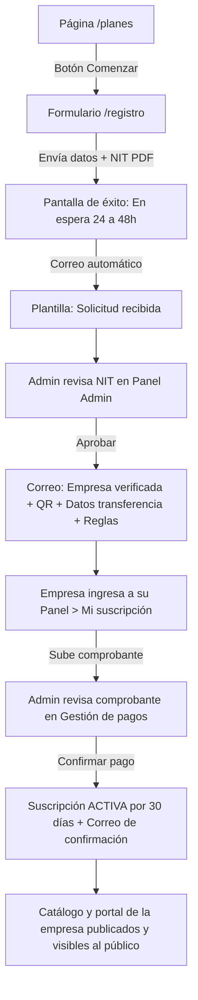

# UNIMARKET BO

Sistema de Gestión de Catálogos Digitales Multiempresa con Búsqueda Avanzada.
Stack: Node.js + Express (API REST) · PostgreSQL · React + Vite + Tailwind CSS + Framer Motion.

## Usuarios de prueba

| Rol           | Usuario    | Contraseña   |
|---------------|------------|--------------|
| Administrador | `admin`    | `admin123`   |
| Empresa       | `empresa1` | `empresa123` |

## Puesta en marcha

Requisitos: Node.js 18+ y PostgreSQL en ejecución.

```bash
# 1) Backend
cd backend
cp .env.example .env        # ajuste usuario/clave de PostgreSQL en DATABASE_URL
npm install
npm run setup               # crea la BD "unimarket", tablas y datos iniciales (plan, empresa1, admin)
npm run dev                 # API en http://localhost:4000

# 2) Frontend (otra terminal)
cd frontend
npm install
npm run dev                 # App en http://localhost:5173
```

## Configuración del servicio de correo (Gmail SMTP)

El sistema envía notificaciones profesionales automáticas para los siguientes eventos:
1. **Solicitud recibida:** Al registrar una nueva empresa (plazo de revisión legal de 24 a 48 horas).
2. **Empresa aprobada:** Cuando el administrador verifica el NIT, incluyendo los siguientes pasos, reglas de uso, soporte e instrucciones de pago por QR o transferencia bancaria.
3. **Solicitud observada:** Si el administrador rechaza el documento de NIT con las correcciones requeridas.
4. **Pago confirmado:** Al validar el comprobante de pago, activando la suscripción por 30 días y publicando el portal en el catálogo.
5. **Aviso de vencimiento:** Enviado 5 días antes de que expire la suscripción.

### Generación de Contraseña de Aplicación de Gmail

Para enviar correos reales desde la cuenta oficial `unimarketbo@gmail.com`:
1. Inicie sesión en la cuenta de Google (`unimarketbo@gmail.com`).
2. Diríjase a **Cuenta de Google > Seguridad**.
3. Asegúrese de que la **Verificación en dos pasos** esté activada.
4. En el buscador o en Seguridad, ingrese a **Contraseñas de aplicaciones**.
5. Asigne un nombre descriptivo (por ejemplo: `UNIMARKET BO Backend`) y haga clic en **Crear**.
6. Google generará una clave privada de 16 caracteres (formato: `xxxx xxxx xxxx xxxx`).
7. Copie esta clave en su archivo local `backend/.env`:
   ```env
   SMTP_HOST=smtp.gmail.com
   SMTP_PORT=465
   SMTP_SECURE=true
   SMTP_USER=unimarketbo@gmail.com
   SMTP_PASS=tu_contrasena_de_16_caracteres_sin_espacios
   MAIL_FROM="UNIMARKET BO <unimarketbo@gmail.com>"
   APP_URL=http://localhost:5173
   ```

> [!IMPORTANT]
> **Seguridad de credenciales:**
> NUNCA escriba la contraseña de aplicación en el código fuente, en el `README.md` ni en repositorios públicos. El archivo `.env` está expresamente incluido en `.gitignore`.
>
> **Límite diario de Gmail:**
> Las cuentas personales de Gmail tienen un límite de envío diario de aproximadamente **500 correos al día**. Para volúmenes mayores en producción, configure un proveedor transaccional (ej. SendGrid, Resend, Amazon SES).
>
> **Modo Fallback / Desarrollo:**
> Si `SMTP_PASS` no está configurado o el servicio SMTP no está disponible, el sistema **no falla ni detiene la operación**: imprime el correo completo en la consola del servidor (destinatario, asunto, cuerpo HTML/texto) y registra el evento en la tabla `notificacion_correo`.

## Configuración de datos para pagos fuera de plataforma (QR y Transferencia)

Conforme al límite 1.6.2 del perfil de grado, **el sistema no procesa pagos directamente**; las transferencias y pagos se realizan fuera de la plataforma (por QR o cuenta bancaria) y el responsable valida el comprobante.

En `backend/.env`, configure los datos bancarios oficiales:
```env
PAGO_BANCO="Banco Unión"
PAGO_TITULAR="UNIMARKET BO S.R.L."
PAGO_CUENTA="10000012345678"
PAGO_TIPO_CUENTA="Cuenta Corriente"
SOPORTE_HORARIO="Lunes a Viernes de 08:30 a 18:30"
```

La imagen del código QR para cobros de la suscripción (Plan Único · Bs 200/mes) se ubica en:
`backend/assets/qr-pago.png`
Se incluye inline con Content-ID (`cid:qr-pago`) en los correos y está disponible para descarga directa en el panel de la empresa.

## Estructura del proyecto

```
unimarket/
├── database/schema.sql          # Tablas (usuario, empresa, suscripcion, verificacion, plan, pago, notificacion_correo)
├── backend/
│   ├── assets/qr-pago.png       # Imagen oficial del QR para pagos
│   ├── scripts/
│   │   ├── setup.js             # Crea BD + tablas + seed inicial (plan, usuarios)
│   │   └── test-flujo-completo.js # Suite de validación de los 11 criterios de aceptación
│   └── src/
│       ├── server.js            # Helmet, CORS, cron horario de vencimientos de suscripción
│       ├── middleware/          # auth (JWT/roles), upload (PDF NITs y comprobantes)
│       ├── routes/
│       │   ├── auth.js          # Login, registro con rate-limit y verificación
│       │   ├── publico.js       # Catálogo, portal público, GET /categorias (con conteo), GET /categorias/:id/resumen (con caché 60s), GET /empresas (directorio con filtros y paginación), GET /plan, GET /reglas
│       │   ├── empresa.js       # Catálogo propio, perfil, subida y consulta de comprobantes (/pagos)
│       │   └── admin.js         # Verificaciones NIT, reenvío de correos, gestión y confirmación de pagos
│       └── utils/
│           ├── correo.js        # Motor de plantillas responsivas HTML/texto y cliente nodemailer
│           ├── reglas.js        # 7 Reglas de uso oficiales de la plataforma
│           └── normalizar.js    # Módulo de normalización de datos
└── frontend/src/
    ├── pages/
    │   ├── Inicio.jsx           # Catálogo con filtros sincronizados en la URL (?categoria=, ?q=), franja compacta de tiendas verificadas
    │   ├── Empresas.jsx         # Directorio público de empresas verificadas con buscador, filtro por categoría y paginación
    │   ├── Planes.jsx           # Tarjeta "Plan Único · Bs 200/mes", beneficios, pasos y FAQs
    │   ├── Terminos.jsx         # Reglas de uso y delimitación 1.6.2
    │   ├── Registro.jsx         # Formulario con validación de correo, confirmación, y pantalla de espera
    │   ├── Login.jsx            # Autenticación JWT
    │   ├── PanelEmpresa.jsx     # Catálogo, portal y pestaña "Mi suscripción" (envío de comprobantes)
    │   └── PanelAdmin.jsx       # Verificación NIT (resaltado >48h) y pestaña "Gestión de pagos"
    └── components/              # MenuExplorar (mega menú y drawer móvil), Modal (portal al body), GaleriaProducto, TarjetaProducto, ModalDetalleProducto
```

### Rutas de la API Pública de Exploración y Directorio
- `GET /api/publico/categorias`: Retorna las categorías disponibles junto con `total_productos` (conteo exacto de productos de empresas verificadas con suscripción activa). Incluye caché en memoria de 60 segundos. Las categorías con 0 productos se incluyen para permitir explorar todo el árbol temático.
- `GET /api/publico/categorias/:id/resumen`: Retorna el detalle de la categoría, las empresas que ofrecen productos en dicho rubro y hasta 4 productos destacados con su primera imagen (con caché en memoria de 60 segundos).
- `GET /api/publico/empresas`: Directorio de empresas verificadas con suscripción activa, con soporte de parámetros de búsqueda `?q=`, filtro de rubro `?categoria=` y paginación mediante `?pagina=` y `?limite=`.

## Flujo integral implementado



## Seguridad implementada

1. **CORS restringido y cabeceras seguras con helmet.**
2. **Rate limiting:** 10 registros por hora por IP en `POST /api/auth/registro-empresa`.
3. **Validación estricta de entradas:** NIT, teléfono y WhatsApp solo dígitos; correo único validado y con campo de confirmación; contraseñas con longitud mínima.
4. **Protección XSS en correos:** Escape automático de caracteres HTML (`<`, `>`, `&`, `"`, `'`) en razones sociales y observaciones antes de renderizar las plantillas.
5. **Aislamiento multiempresa:** El `id_empresa` se extrae exclusivamente del JWT verificado en las rutas privadas.
6. **Almacenamiento seguro de archivos:** Los archivos PDF del NIT y los comprobantes de pago se almacenan fuera del directorio público estático y solo se sirven previa autorización por token.
7. **Consultas 100% parametrizadas en PostgreSQL:** Prevención integral contra inyección SQL.

---
*UNIMARKET BO · Proyecto de Grado TMG-600*
